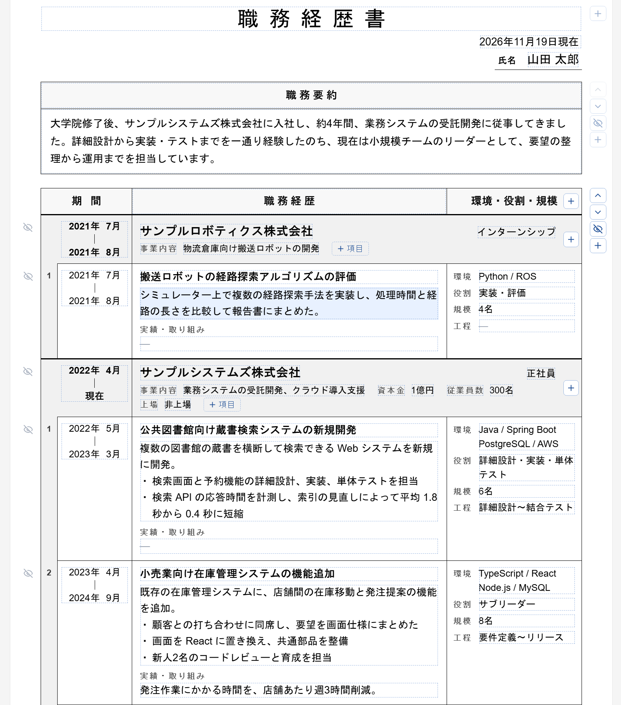

# cv

Curricula vitae kept as data: a [react-doc](https://github.com/wwf971/react-doc) package that keeps a person's information once, in a **profile**, and draws the papers of that person from it, each edited in place. Two forms so far: the Japanese-style CV (cv-jp) and the Japanese-style work experience (we-jp).

[](https://wwf971.github.io/cv-dev/)

**Try it:** [wwf971.github.io/cv-dev](https://wwf971.github.io/cv-dev/), the doc page of the package with its made-up example person, read-only.

The repository is the package: `doc-package.yaml` is its config, `doc/README.md` its root document. Launched as a doc page, it shows its documents and its demonstration, and the papers can be edited:

```sh
node <react-doc checkout>/main/frontend/cli/doc-cli.js dev <this folder> --port 45190
npm test                           # the data layer: query paths, the sheet, the career
sh script-build/pages-deploy.sh    # build the static page from what is committed and publish it on the branch gh-pages
```

- [doc/README.md](doc/README.md): the package, what it holds and how to use it
- [doc/cv-demo.md](doc/cv-demo.md): the demonstration, edited in place while the package is served alone

Your own data stays on your machine: it goes in the partition `real` of the two frontend objects, which git ignores, and the page is built from what is committed only ([doc/README.md](doc/README.md#partitions)).

The former Vue project of this repository is deprecated; it is kept in [vue-legacy/](vue-legacy/README.md).
